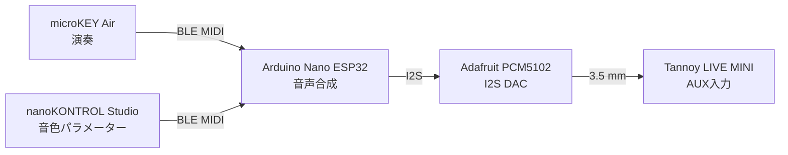

# Arduino Nano ESP32 バーチャルアナログ・シンセ

[English](README.md) | [Japanese](README.ja.md)

## 概要

Arduino Nano ESP32を基盤にした独自のモノフォニック・シンセサイザーです。音を自由に設計できるように、ソフトウェアでオシレーター、フィルター、エンベロープ、モジュレーションを実装し、音色を構成します。

入力には既製品のMIDIコントローラー、出力には既製品のスピーカーを利用します。

## 機能

- **音色**: 4種類の波形、2オシレーターのデチューン、レゾナンス付きローパスフィルター、ADSRエンベロープ（音量・フィルター）、LFO、グライド、音程の揺らぎ。
- **演奏**: microKEY Airで、モノシンセとして弾きます。
- **音作り**: nanoKONTROL Studioで、演奏しながら音色を操作します。

## 構成

## 部品表

| 部品                                                                                                                                                   | 数量    | 用途・備考                                     |
| ------------------------------------------------------------------------------------------------------------------------------------------------------ | ------- | ---------------------------------------------- |
| [Arduino Nano ESP32](https://amzn.to/4apayDa)                                                                                                          | 1       | 音声合成とBLE MIDIの受信。                     |
| [Adafruit PCM5102 I2S DAC](https://learn.adafruit.com/adafruit-pcm510x-i2s-dac)（[スイッチサイエンス](https://www.switch-science.com/products/10382)） | 1       | 音声出力。ピンヘッダーのはんだ付けが必要です。 |
| [3.5 mmステレオジャック MJ-074N（パネル絶縁あり）](https://www.marutsu.co.jp/pc/i/9978/)                                                               | 2       | DACの出力用。1個は予備です。                   |
| ブレッドボードとジャンパー線                                                                                                                           | 1セット | 配線用。                                       |
| 3.5 mmステレオ オス-オスケーブル                                                                                                                       | 1       | ジャックとスピーカーの接続用。                 |
| USB Type-Cケーブル                                                                                                                                     | 1       | 給電と書き込み用。                             |

### 外部接続機材

| 機材                    | 用途・備考                        |
| ----------------------- | --------------------------------- |
| KORG microKEY Air       | 演奏用のMIDIキーボード。          |
| KORG nanoKONTROL Studio | 音作り用のMIDIコントローラー。    |
| Tannoy LIVE MINI        | スピーカー。AUX入力に接続します。 |

## 開発

### フェーズ

| フェーズ    | 目標                                 | 完了条件                                           |
| ----------- | ------------------------------------ | -------------------------------------------------- |
| 1. 音声出力 | DACからサイン波を鳴らす。            | 雑音や音切れなく鳴る。                             |
| 2. 演奏     | microKEY Airで音を鳴らす。           | 正しい音程で、クリックノイズなく発音・消音できる。 |
| 3. 音色     | アナログ風の音色を作る。             | 各要素の変化を聴き分けられる。                     |
| 4. 音作り   | nanoKONTROL Studioで音色を操作する。 | 演奏しながら音を作れる。                           |

### フェーズ1: 音声出力

#### 仕様

- 音量は小さめから始めます。

**未決事項**

| 項目               | 決め方                                              |
| ------------------ | --------------------------------------------------- |
| 音声合成ライブラリ | Mozziか自作コードか、最初の音を出す段階で決めます。 |
| サンプリングレート | 32 kHzまたは44.1 kHzで始めます。                    |
| I2Sのピン          | 空いているGPIOを3本選びます。                       |

#### ハードウェア開発

1. DACにピンヘッダーをはんだ付けします。
2. DACの出力とジャックを接続します（L→チップ、R→リング、GND→スリーブ）。
3. DACの電源を3.3 VとGND、BCLK・WSEL・DINをGPIOに接続します。
4. ジャックとスピーカーのAUX入力をケーブルでつなぎます。

#### ソフトウェア開発

1. サイン波を生成し、I2Sで出力します。

#### テスト

数分間鳴らし、雑音や音切れがないことを確認します。

### フェーズ2: 演奏

#### 仕様

- Nano ESP32をBLE MIDIのクライアントとして動かします。
- BLEと音声合成は別々のコアで動かします。

**未決事項**

| 項目               | 決め方                                               |
| ------------------ | ---------------------------------------------------- |
| BLE MIDIライブラリ | ESP32-BLE-MIDIなど、クライアント動作に対応したもの。 |

#### ハードウェア開発

なし。

#### ソフトウェア開発

1. microKEY Airに接続します。
2. ノートオンで発音し、ノートオフで短くフェードアウトして消音します。

#### テスト

各鍵盤の音程と、発音・消音時にクリックノイズがないことを確認します。

### フェーズ3: 音色

#### ハードウェア開発

なし。

#### ソフトウェア開発

1. 波形とデチューンを追加します。
2. フィルターとADSRエンベロープを追加します。
3. LFO、グライド、音程の揺らぎを追加します。

#### テスト

各パラメーターを変え、音の変化を耳で確認します。

### フェーズ4: 音作り

#### 仕様

- フェーダーをエンベロープ、つまみをオシレーター・フィルター・LFO、ボタンを波形の切り替えに割り当てます。

**未決事項**

| 項目     | 決め方                                                         |
| -------- | -------------------------------------------------------------- |
| 同時接続 | microKEY AirとnanoKONTROL Studioを同時に接続できるか試します。 |
| CC番号   | KORG KONTROL Editorで確認します。                              |

#### ハードウェア開発

なし。

#### ソフトウェア開発

1. nanoKONTROL Studioに接続します。
2. コントロールチェンジを音色パラメーターに割り当て、変化を平滑化します。

#### テスト

演奏しながら各操作子を動かし、音が滑らかに変わることを確認します。

## 参考資料

- [Arduino開発手順](../../../../docs/arduino-development.ja.md)
- [Arduino Nano ESP32 ドキュメント](https://docs.arduino.cc/hardware/nano-esp32/)
- [Mozzi サウンド合成ライブラリ](https://sensorium.github.io/Mozzi/)

## ライセンス

## サポート

役に立った場合は、サポートをご検討ください:

## 作者

[Asami.K](https://asami.tokyo/)
