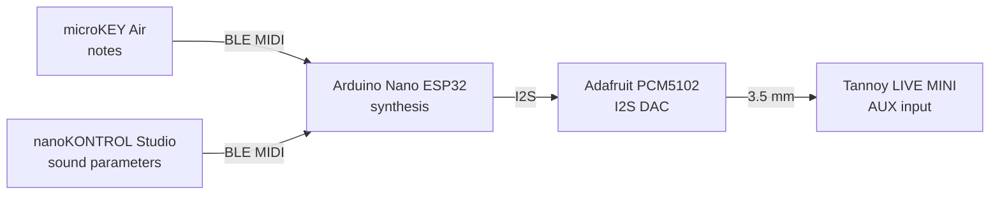

# Arduino Nano ESP32 Virtual Analog Synth

[English](README.md) | [Japanese](README.ja.md)

## Overview

An original monophonic synthesizer based on the Arduino Nano ESP32. To allow free sound design, the voice is built in software from oscillators, a filter, envelopes, and modulation.

It uses an off-the-shelf MIDI controller for input and an off-the-shelf speaker for output.

## Features

- **Voice**: four waveforms, two detuned oscillators, resonant low-pass filter, ADSR envelopes (amplitude and filter), LFO, glide, and pitch drift.
- **Playing**: the microKEY Air plays the voice as a monophonic synth.
- **Sound design**: the nanoKONTROL Studio controls the voice while playing.

## Architecture

## Bill of Materials

| Part | Quantity | Role / Notes |
| --- | --- | --- |
| [Arduino Nano ESP32](https://amzn.to/4apayDa) | 1 | Synthesis and BLE MIDI reception. |
| [Adafruit PCM5102 I2S DAC](https://learn.adafruit.com/adafruit-pcm510x-i2s-dac) ([Switch Science](https://www.switch-science.com/products/10382)) | 1 | Audio output. Pin headers need soldering. |
| [3.5 mm stereo jack MJ-074N (panel insulated)](https://www.marutsu.co.jp/pc/i/9978/) | 2 | DAC output. One is a spare. |
| Breadboard and jumper wires | 1 set | Wiring. |
| 3.5 mm stereo male-to-male cable | 1 | Connects the jack to the speaker. |
| USB Type-C cable | 1 | Power and upload. |

### External equipment

| Equipment | Role / Notes |
| --- | --- |
| KORG microKEY Air | MIDI keyboard for playing. |
| KORG nanoKONTROL Studio | MIDI controller for sound design. |
| Tannoy LIVE MINI | Speaker. Connected to its AUX input. |

## Development

### Phases

| Phase | Goal | Done when |
| --- | --- | --- |
| 1. Audio output | Play a sine wave from the DAC. | It plays without noise or dropouts. |
| 2. Playing | Play notes from the microKEY Air. | Notes have the correct pitch and start and stop without clicks. |
| 3. Voice | Build the analog-style voice. | Each element can be heard changing. |
| 4. Sound design | Control the voice from the nanoKONTROL Studio. | A sound can be designed while playing. |

### Phase 1: Audio output

#### Specification

- Start with low volume.

**Open questions**

| Item | How to decide |
| --- | --- |
| Synthesis library | Mozzi or custom code; decide when the first tone plays. |
| Sample rate | Start at 32 kHz or 44.1 kHz. |
| I2S pins | Pick three free GPIOs. |

#### Hardware Development

1. Solder the pin headers to the DAC.
2. Wire the DAC outputs to the jack (L to tip, R to ring, GND to sleeve).
3. Wire the DAC power to 3.3 V and GND, and BCLK, WSEL, and DIN to GPIOs.
4. Connect the jack to the speaker AUX input with the cable.

#### Software Development

1. Generate a sine wave and output it over I2S.

#### Test

Play for several minutes and confirm there is no noise or dropout.

### Phase 2: Playing

#### Specification

- Run the Nano ESP32 as a BLE MIDI client.
- Run BLE and synthesis on separate cores.

**Open questions**

| Item | How to decide |
| --- | --- |
| BLE MIDI library | One with client support, such as ESP32-BLE-MIDI. |

#### Hardware Development

None.

#### Software Development

1. Connect to the microKEY Air.
2. Start a note on note-on, and stop it with a short fade on note-off.

#### Test

Confirm each key's pitch and that notes start and stop without clicks.

### Phase 3: Voice

#### Hardware Development

None.

#### Software Development

1. Add the waveforms and detune.
2. Add the filter and ADSR envelopes.
3. Add the LFO, glide, and pitch drift.

#### Test

Change each parameter and listen to the change.

### Phase 4: Sound design

#### Specification

- Assign faders to the envelopes, knobs to the oscillators, filter, and LFO, and buttons to waveform select.

**Open questions**

| Item | How to decide |
| --- | --- |
| Simultaneous connections | Test whether the microKEY Air and nanoKONTROL Studio can connect at the same time. |
| CC numbers | Check them in KORG KONTROL Editor. |

#### Hardware Development

None.

#### Software Development

1. Connect to the nanoKONTROL Studio.
2. Map control changes to voice parameters and smooth the changes.

#### Test

Move each control while playing and confirm the sound changes smoothly.

## References

- [Arduino development guide](../../../../docs/arduino-development.md)
- [Arduino Nano ESP32 documentation](https://docs.arduino.cc/hardware/nano-esp32/)
- [Mozzi sound synthesis library](https://sensorium.github.io/Mozzi/)

## License

## Support

If you find this helpful, consider supporting the work:

## Author

[Asami.K](https://asami.tokyo/)
