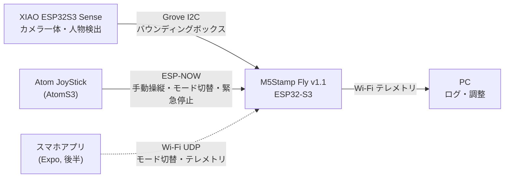

# 室内向け自律追従型 AIマイクロドローン

[English](README.md) | [Japanese](README.ja.md)

## 概要

> ステータス: 計画中。ファームウェアとアプリのコードはまだありません。このREADMEには要件と開発計画をまとめています。

人物を検出して自動で追従する、室内向けの小型ドローンです。M5Stamp Fly v1.1（ESP32-S3）をベースに、カメラ一体のXIAO ESP32S3 Senseを後付けします。機体に載せたXIAO ESP32S3 Senseで人物検出を行い、フライトコントローラーがバウンディングボックスをヨー・ロール・ピッチの目標値に変換します。手動操縦と自律追従モードはコントローラーで切り替えます。

## 機能

- 室内で人物を検出し、一定の距離を保って追従する。
- 標準搭載の気圧センサー・ToFセンサー・オプティカルフローセンサーで高度と位置を維持する。
- コントローラーで手動モードと自律モードを切り替え、いつでもすぐに手動操作へ戻せるようにする。
- 実機で飛ばす前に、追従ロジックをシミュレーターで検証する。

### 対象外

- 屋外飛行、GPS、長距離飛行。
- 複数人の追従や特定人物の識別。

## アーキテクチャ

| 層             | デバイス                      | 役割                                                                      |
| -------------- | ----------------------------- | ------------------------------------------------------------------------- |
| エッジAI       | XIAO ESP32S3 Sense            | 人物検出を実行し、バウンディングボックス（x, y, w, h, スコア）をI2Cで出力 |
| 機体制御       | M5Stamp Fly v1.1              | 姿勢安定化、AI結果の取得、追従PID、コマンド受信                           |
| コントローラー | Atom JoyStick                 | 物理スティックによる手動操縦、モード切替、緊急停止                        |
| アプリ（後半） | スマホ（React Native / Expo） | 追従モードの切替、テレメトリ表示、パラメーター調整                        |

### 追従制御

| 入力（バウンディングボックス）   | 誤差               | 出力先                       |
| -------------------------------- | ------------------ | ---------------------------- |
| 水平方向の中心 `x`               | 画像中心からのズレ | ヨーレート（人物の方へ旋回） |
| ボックスの高さ `h`（距離の近似） | 目標サイズとの差   | ピッチ（前後移動）           |
| 垂直方向の中心 `y`               | 画像中心からのズレ | 任意: 高度目標               |

- まずヨーだけで追従し、必要な場合だけロールを追加します。ヨーは最も調整しやすい軸です。
- 画像中心と目標サイズの周りに不感帯を設け、機体が振動しないようにします。
- 一定時間（例: 0.5秒）人物が検出されなければ、追従を止めてホバリングします。
- 追従の出力はすべて上限でクランプし、姿勢制御の許容範囲内に収めます。

## 部品表

| 部品                                                                                   | 数量 | 用途・備考                                                                                                                |
| -------------------------------------------------------------------------------------- | ---- | ------------------------------------------------------------------------------------------------------------------------- |
| [M5Stamp Fly v1.1 (K138-V11)](https://link.amazon/B08fEUBrB)                           | 1    | フライトコントローラー兼機体。ESP32-S3（Stamp-S3A）。約27.6g、320mAhバッテリー、飛行時間約4分。コントローラーは付属しない |
| [Atom JoyStick](https://link.amazon/B01ZRaFbh)                                         | 1    | 物理コントローラー（AtomS3 + STM32）。ドローンとESP-NOWで通信。シミュレーター用のUSBゲームパッドとしても使える            |
| [XIAO ESP32S3 Sense](https://link.amazon/B0gBKLuE7)                                    | 1    | エッジAIモジュール（ESP32-S3、カメラ一体）。SenseCraft AIで人物検出モデルを書き込み、結果をI2Cで出力する                  |
| [Grove - Universal 4 Pin Buckled 5cm Cable(5 PCs Pack)](https://link.amazon/B00Grt336) | 1    | XIAOとStamp Flyの赤いGroveポートをI2Cで接続。5本入り。XIAOにはGroveコネクターがないため、片側を切ってXIAOにはんだ付けする |
| 3Dプリントマウント                                                                     | 1    | XIAOを固定する。[フェーズ4のマウント設計](#フェーズ4-ペイロード試験)を参照                                                |

Raspberry Pi用に保管しているGrove Vision AI V2とOV5647-62は、推論周期が足りない場合の代替として使えます（フェーズ3の検討項目）。

### 予備

| 部品                                                                                                                                              | 数量 | 用途・備考                                                                                                                                     |
| ------------------------------------------------------------------------------------------------------------------------------------------------- | ---- | ---------------------------------------------------------------------------------------------------------------------------------------------- |
| [StampFly Accessory Kit (Motors + Propellers)](https://shop.m5stack.com/products/stampfly-accessory-kit-motors-propellers?variant=45727275680001) | 適宜 | 墜落時の交換部品（A147）。0.8mm穴プロペラ4個、コアレスモーター（時計回り2個・反時計回り2個）、プロペラ外し工具。取り付け時は回転方向を確認する |
| BETAFPV 1S 320mAh                                                                                                                                 | 適宜 | 予備バッテリー。v1.1付属品と同じ4.35V HVタイプ。単体の販売先は未確認。フェーズ4以降に、付属品のコネクターと寸法に合う1S HVバッテリーを探す     |

## 開発

### フェーズ

| フェーズ                                                   | 目標                                                                                   | 完了条件                                                     |
| ---------------------------------------------------------- | -------------------------------------------------------------------------------------- | ------------------------------------------------------------ |
| [1. キット準備と試験飛行](#フェーズ1-キット準備と試験飛行) | バッテリーを充電し、Atom JoyStickとペアリングして、改造前のStamp Flyを飛ばす           | 高度維持で安定してホバリングできる                           |
| [2. シミュレーター](#フェーズ2-シミュレーター)             | stampfly_ecosystemのSILSで、ダミーのバウンディングボックスを使って追従ロジックを動かす | 動く目標に対して、シミュレーター上の機体が旋回し距離を保てる |
| [3. AIモジュール単体](#フェーズ3-aiモジュール単体)         | XIAO ESP32S3 Senseの結果をI2Cで読み、シリアルに出力する                                | 飛行なしで、バウンディングボックスが一定周期で届く           |
| [4. ペイロード試験](#フェーズ4-ペイロード試験)             | AIモジュールを搭載して飛行を確認する                                                   | 搭載状態で安定してホバリングでき、飛行時間を記録できる       |
| [5. ヨーのみ追従](#フェーズ5-ヨーのみ追従)                 | 実機でヨーのループを閉じる                                                             | 機体が人物の方を向く                                         |
| [6. 完全追従](#フェーズ6-完全追従)                         | ピッチ（距離）と必要に応じてロールを追加する                                           | 設定した距離で人物を追従する                                 |
| [7. スマホアプリ](#フェーズ7-スマホアプリ)                 | Expoアプリからモード切替とテレメトリ表示                                               | アプリからモードを切り替えられる                             |

安全: 障害物のない部屋で、ネットや柔らかい床の上で飛ばします。保護メガネを着用します。追従ゲインと速度上限は低い値から始めます。自律飛行中も、コントローラーは常に手に持っておきます。

### フェーズ1: キット準備と試験飛行

改造前のStamp Flyを飛ばし、機体とコントローラーに問題がないことを確認します。後のフェーズで不具合が出たときに、原因を切り分ける基準になります。

#### ハードウェア開発

1. 付属バッテリーを充電する（5V 1A、約55分）。
2. プロペラの向きと固定を確認する。
3. Atom JoyStickの電源を入れ、Stamp Flyとペアリングする。

#### ソフトウェア開発

- 工場出荷時のファームウェアのまま使います。書き換えはフェーズ2以降に行います。

#### テスト

1. 低い高度で離陸し、ホバリング・前後左右の移動・着陸を試す。
2. 1回の飛行時間を記録する（以降のフェーズとの比較用）。

| テスト     | 方法                             | 合格基準                       |
| ---------- | -------------------------------- | ------------------------------ |
| ホバリング | 高度維持モードで離陸し、手を離す | 大きく流れずに高度と位置を保つ |
| 手動操作   | 各スティックを少しずつ動かす     | 入力した方向に素直に動く       |
| 着陸・停止 | 着陸操作とモーター停止を試す     | 安全に着陸し、モーターが止まる |

### フェーズ2: シミュレーター

開発環境を用意し、追従ロジックをシミュレーター上で作ります。ここで作った制御コードを、フェーズ5以降で実機に載せます。

#### 仕様

- ベースファームウェアは [stampfly_ecosystem](https://github.com/M5Fly-kanazawa/stampfly_ecosystem) を使う。シミュレーターと実機で同じ制御コードが動き、スマホアプリ用のUDP APIもあるため。
- 追従ロジックは `sf app new` で作るアプリとして実装し、ecosystem本体は変更しない。
- [追従制御](#追従制御)の表に従い、バウンディングボックスからヨー・ピッチの目標値を作る。PIDは検出の周期で動かす。
- 入力にはタイムスタンプを付け、古いデータや一定時間の未検出ではホバリングに戻す。
- 優先順位は 緊急停止 > 手動スティック > 自律追従。

ベースファームウェアの比較

| ベース                                                                     | 環境                                | 長所                                                                                                                                   | 短所                                                                                             |
| -------------------------------------------------------------------------- | ----------------------------------- | -------------------------------------------------------------------------------------------------------------------------------------- | ------------------------------------------------------------------------------------------------ |
| [M5StampFly](https://github.com/M5Fly-kanazawa/M5StampFly)（公式）         | Arduino / PlatformIO                | SSCMAのArduinoライブラリをそのまま使える                                                                                               | シミュレーターがない。新しい制御コードを追加する構造が少ない                                     |
| [stampfly_ecosystem](https://github.com/M5Fly-kanazawa/stampfly_ecosystem) | ESP-IDF v5.5.2 + FreeRTOS、`sf` CLI | SILSと3Dシミュレーター、コントローラー用ファームウェア、Wi-Fiテレメトリとログ、UDPとTello SDK互換API、`sf app new`によるユーザーアプリ | Arduinoではない。SSCMAのI2Cプロトコルを移植するか、ESP-IDFコンポーネントとして組み込む必要がある |

**検討項目**

| 項目                   | 決め方                                                                                                     |
| ---------------------- | ---------------------------------------------------------------------------------------------------------- |
| v1.1への対応           | 手順2で確認する。動かなければ実機は公式のM5StampFly（Arduino）にし、シミュレーターはロジック検証だけに使う |
| 未検出時のタイムアウト | 仮の値は0.5秒。一瞬隠れても切れず、見失ったらすぐ止まる値をシミュレーターで選ぶ                            |

#### ハードウェア開発

1. Atom JoyStickをUSBでPCにつなぐ（シミュレーターのゲームパッドとして使う）。

#### ソフトウェア開発

1. stampfly_ecosystemの `sf` CLIをインストールする（Python 3.10〜3.12、ESP-IDFはインストーラーが用意する）。
2. v1.1にecosystemのファームウェアを書き込み、手動で飛ばせるか確認する。ecosystemのREADMEには「M5Stamp S3」とだけあり、v1.1のStampS3Aへの対応は書かれていない。
3. SILSを起動し、Atom JoyStickで手動で飛ばす。
4. `sf app new` で追従用のアプリを作り、仕様に沿って追従ロジックを実装する。
5. 仮想の人物の位置からダミーのバウンディングボックスを作り、追従ロジックに入力する。
6. 追従PIDのゲイン、不感帯、出力上限を調整する。

#### テスト

| テスト             | 方法                       | 合格基準                         |
| ------------------ | -------------------------- | -------------------------------- |
| シミュレーター追従 | SILSで動くダミー目標を使う | 振動せず、数秒以内に収束する     |
| 目標の見失い       | ダミー目標の出力を止める   | タイムアウト内にホバリングへ移る |
| 手動介入           | 追従中にスティックを動かす | すぐに手動操作へ戻る             |

### フェーズ3: AIモジュール単体

XIAO ESP32S3 SenseをStamp Flyにつなぎ、飛ばさずに検出結果を読めるようにします。

#### 仕様

**配線**

| XIAO ESP32S3 Sense        | M5Stamp Fly v1.1（赤いGroveポート） |
| ------------------------- | ----------------------------------- |
| D4 / GPIO5 (SDA)          | G13 (SDA)                           |
| D5 / GPIO4 (SCL)          | G15 (SCL)                           |
| 3V3 または 5V（検討項目） | VCC                                 |
| GND                       | GND                                 |

- Stamp Flyのピン配置では、赤いGroveポートがI2C（G13/G15）、黒いポートがG1/G2です。配線前に基板上のピンを確認してください。
- Groveケーブルは片側を切り、XIAOのパッドに直接はんだ付けします。コネクターを使わないので、振動で抜けません。
- XIAOは飛行用バッテリーを共有するため、飛行時間が短くなります。消費電流を測定してください。

**I2C読み取り**

- AIモジュールの読み取りは、姿勢制御ループとは別のタスクで行います。I2Cの読み取りが遅れても、安定化を止めてはいけません。
- 最新の結果をタイムスタンプ付きで渡し、追従ロジックが古いデータを判別できるようにします。
- XIAOはSenseCraft AIのファームウェアで、結果をI2Cで出力します。Stamp Fly側は [Seeed_Arduino_SSCMA](https://github.com/Seeed-Studio/Seeed_Arduino_SSCMA) のI2Cプロトコルで読みます。

**検討項目**

| 項目               | 決め方                                                                                                               |
| ------------------ | -------------------------------------------------------------------------------------------------------------------- |
| Groveポートの電圧  | 3.3Vか5Vか資料で確認できていない。配線前にテスターで測り、3.3VならXIAOの3V3ピン、5Vなら5Vピンにつなぐ                |
| I2Cのプルアップ    | XIAOのI2Cにはプルアップ抵抗が必要な場合がある。Stamp Fly側にプルアップがあるか確認し、なければ追加する               |
| SSCMAの組み込み方  | (a) 結果を読む部分だけESP-IDFに移植、(b) Arduino as a componentで使う。まず(a)を試し、ビルドに組み込みやすい方を選ぶ |
| 人物検出モデル     | SenseCraft AIのXIAO ESP32S3 Sense対応モデルから、1〜2m先の検出精度と推論周期を比べて選ぶ                             |
| AIモジュールの変更 | 推論周期が追従に足りない場合は、保管しているGrove Vision AI V2とOV5647-62に切り替える（I2Cの読み方は同じ）           |

#### ハードウェア開発

1. XIAO ESP32S3 Senseにカメラ基板が確実に取り付けられているか確認する。
2. Groveポートの電圧を測り、5cmのGroveケーブルの片側をXIAOのSDA・SCL・電源・GNDにはんだ付けする。
3. もう片側をStamp Flyの赤いGroveポートに挿す。
4. プロペラを外すか、モーターが回らない状態で作業する。

#### ソフトウェア開発

1. SenseCraft AIでXIAO ESP32S3 Senseに人物検出モデルを書き込み、出力先をI2Cに設定する。
2. Stamp FlyにI2Cの読み取りタスクを実装し、結果をシリアルに出力する。
3. 推論の周期、レイテンシー、消費電流を記録する。追従ループのゲインはこれに依存します。

#### テスト

| テスト      | 方法                       | 合格基準                                 |
| ----------- | -------------------------- | ---------------------------------------- |
| I2C読み取り | ベンチでシリアル出力を確認 | 周期が安定し、ブロックやバスエラーがない |
| 検出        | 1〜2m先に人が立つ          | 人物を安定して検出し、座標が追従する     |

### フェーズ4: ペイロード試験

XIAO ESP32S3 Senseを載せるマウントを作り、搭載状態で安定して飛べることを確認します。

#### 仕様

**マウント設計**

Bambu Lab P1Sで最小限のマウントを印刷します。次のルールに沿って設計します。

1. **重心を中央に保つ。** モジュールの重さがフレームの中心に来るように配置します。前が重いと機体は常に前へ流れ、制御が補正し続けることになります。カメラを前向きにする必要がある場合は、AIボードを中心より後ろに置いてバランスを取ります。
2. **センサーをふさがない。** 下向きのToFとオプティカルフローセンサーは床が見える必要があり、前向きのToFは前方が見える必要があります。マウントとケーブルをこれらの視野から外します。
3. **プロペラとの距離を取る。** ケーブルを含め、マウントと各プロペラの回転範囲の間を5mm以上空けます。プロペラの真下に大きな平面を置かないでください。ダウンウォッシュを遮り、推力が落ちます。
4. **軽くする。** マウント単体は数グラムを目標にします。薄い壁（0.8〜1.2mm）にし、板ではなくリブで強度を出し、穴を開けて軽量化します。
5. **振動を抑える。** モーターの振動は映像をぶらし、IMUにノイズを乗せます。マウントとカメラの間に、小さなゴムやTPUのダンパー、またはスポンジテープを挟みます。
6. **カメラの角度を決める。** 1〜2m先の人物を捉えるなら、水平からやや下向き（約0〜15°）から始めます。交換式のくさびなどで、角度を変えやすくしておきます。
7. **アクセスを確保する。** マウントを外さずに、バッテリー・USBポート・電源スイッチを操作できるようにします。
8. **最初は接着しない。** クリップやバンドでフレームに固定し、複数の設計を試せるようにします。PCBフレームには穴を開けないでください。
9. **カメラ基板を押さえる。** XIAO ESP32S3 Senseは本体とカメラ基板を基板間コネクターで重ねた構造です。振動でカメラ基板が外れないよう、マウントで上から押さえます。

**検討項目**

| 項目         | 決め方                                                                           |
| ------------ | -------------------------------------------------------------------------------- |
| 搭載位置     | 上面・前面・下面から、重心を中央に保ち、センサーとプロペラを避けられる位置を選ぶ |
| 固定方法     | クリップかバンドから、機体を傷めず、飛行中に緩まない方を選ぶ                     |
| カメラの角度 | 0〜15°下向きから始め、フェーズ5と6で人物が画像の中央付近に入るよう調整する       |

#### ハードウェア開発

1. ノギスでフレーム・固定位置・モジュールの寸法を測り、機体を上・横・前から撮影する。
2. 単純なトレイやクリップから設計し、印刷する。数回の作り直しを前提にする。初期の勘合確認にはPETGやPLAで十分です。
3. 形が決まったらABSで印刷する。密閉型のP1SはABSに向いていますが、ABSは収縮して反りやすいので、印刷後に勘合を確認する。
4. ペイロード全体（マウント・XIAO・ケーブル）の重さを秤で量る。
5. 機体に取り付け、重心が中央にあるか確認する。
6. バージョンごとに重量・重心・ホバリング時のスロットルを記録する。
7. 何度も飛ばすようになるので、必要なら予備バッテリーを用意する。

#### ソフトウェア開発

- フェーズ3のファームウェアのまま使います（追従はまだ動かさない）。
- Wi-Fiテレメトリで、ホバリング時のスロットルとバッテリー電圧を記録します。

#### テスト

| テスト                   | 方法                           | 合格基準                                     |
| ------------------------ | ------------------------------ | -------------------------------------------- |
| ペイロード搭載ホバリング | 全ペイロードを積んでホバリング | 安定してホバリングでき、飛行時間を記録できる |
| センサー視野             | 搭載状態で高度維持を使う       | ToFとオプティカルフローが正常に働く          |
| 飛行中の検出             | ホバリング中に前に人が立つ     | 飛行中も検出結果がシリアルやログに届く       |

### フェーズ5: ヨーのみ追従

フェーズ2の追従ロジックを実機に載せ、まずヨー（旋回）だけで人物の方を向かせます。

#### ハードウェア開発

- フェーズ4で完成した搭載状態の機体を使います。

#### ソフトウェア開発

1. フェーズ2の追従アプリに、フェーズ3のI2C読み取りタスクの結果を入力としてつなぐ。
2. ピッチとロールの出力は0に固定し、ヨーだけを有効にする。
3. フェーズ2で調整したゲインを低めにして実機に書き込む。
4. Atom JoyStickのボタンに、追従モードの切替を割り当てる。

#### テスト

1. ホバリング中に追従モードへ切り替え、人物がゆっくり左右に動く。
2. ゲインを少しずつ上げて調整する。

| テスト       | 方法                       | 合格基準                         |
| ------------ | -------------------------- | -------------------------------- |
| ヨー追従     | 人物が左右に動く           | 機体が人物の方を向き、振動しない |
| 目標の見失い | カメラから人物を隠す       | タイムアウト内にホバリングへ移る |
| 手動介入     | 追従中にスティックを動かす | すぐに手動操作へ戻る             |
| 緊急停止     | 停止入力を押す             | モーターがすぐに止まる           |

### フェーズ6: 完全追従

距離の制御を加え、人物との距離を保って追従させます。

#### 仕様

**検討項目**

| 項目               | 決め方                                                                            |
| ------------------ | --------------------------------------------------------------------------------- |
| ロールを追加するか | ヨーとピッチだけでは、横に歩く人物が画像の外へ出てしまう場合だけ追加する          |
| 目標距離           | 1〜2mの範囲で安定して検出できる距離を選び、そのときのボックスの高さを目標値にする |

#### ハードウェア開発

- フェーズ5と同じ機体を使います。追従中にカメラの角度が合わない場合は、マウントの角度を調整します。

#### ソフトウェア開発

1. ボックスの高さを使ったピッチ（距離）制御を有効にする。
2. 検討項目に従い、ロールを追加するか決める。
3. 目標距離（目標のボックスの高さ）と速度上限を調整する。

#### テスト

| テスト       | 方法                       | 合格基準                         |
| ------------ | -------------------------- | -------------------------------- |
| 距離維持     | 人物が前後に歩く           | 設定した距離を保って追従する     |
| 目標の見失い | カメラから人物を隠す       | タイムアウト内にホバリングへ移る |
| 手動介入     | 追従中にスティックを動かす | すぐに手動操作へ戻る             |
| 緊急停止     | 停止入力を押す             | モーターがすぐに止まる           |

### フェーズ7: スマホアプリ

スマホからモード切替とテレメトリの表示をできるようにします。手動操縦の主手段は引き続きAtom JoyStickです。

#### 仕様

- 通信はWi-Fi UDPを使う（BLEは使わない）。ecosystemにUDPとTello SDK互換APIがあるため。
- 手動操縦の主手段はAtom JoyStick。アプリより常にJoyStickの操作を優先する。

**検討項目**

| 項目           | 決め方                                                                    |
| -------------- | ------------------------------------------------------------------------- |
| 仮想スティック | フェーズ6までの運用で、JoyStickなしで操作したい場面があれば予備として作る |

#### ハードウェア開発

- スマホを機体のWi-Fiアクセスポイントにつなぎます。

#### ソフトウェア開発

1. React Native（Expo）でアプリを作る。
2. Wi-Fi UDPでモード切替コマンドを送る。
3. 機体からのテレメトリを表示する。

#### テスト

| テスト     | 方法                             | 合格基準                         |
| ---------- | -------------------------------- | -------------------------------- |
| モード切替 | アプリで追従モードを切り替える   | 機体のモードが切り替わる         |
| 通信断     | 追従中にアプリを閉じる           | 機体が安全側（ホバリング）に移る |
| 手動介入   | アプリ使用中にスティックを動かす | Atom JoyStickの操作が優先される  |

## 参考

- [M5Stamp Fly v1.1 (K138-V11)](https://docs.m5stack.com/en/products/sku/K138-V11)
- [StampFly v1.1 アプリガイド](https://docs.m5stack.com/en/app/StampFly_v1.1)
- [Atom JoyStick](https://docs.m5stack.com/en/app/Atom%20JoyStick)
- [M5StampFly 公式ファームウェア](https://github.com/M5Fly-kanazawa/M5StampFly)
- [stampfly_ecosystem](https://github.com/M5Fly-kanazawa/stampfly_ecosystem)
- [XIAO ESP32S3 Sense](https://wiki.seeedstudio.com/xiao_esp32s3_getting_started/)
- [SenseCraft AI: XIAO ESP32S3 SenseをAIセンサーとして使う](https://sensecraft.seeed.cc/wiki/en/sensecraft-ai/guides/models/workspace/sensecraft-ai-output-libraries-xiao/)
- [Grove Vision AI V2](https://wiki.seeedstudio.com/ja/grove_vision_ai_v2/)（代替時）
- [Seeed_Arduino_SSCMA](https://github.com/Seeed-Studio/Seeed_Arduino_SSCMA)
- 関連プロジェクト: [Vision AI Camera](../../../../sbc/Raspberry_Pi_5/Vision_AI_Camera/README.ja.md)

## ライセンス

## サポート

役に立った場合は、サポートをご検討ください:

## 作者

[Asami.K](https://asami.tokyo/)
