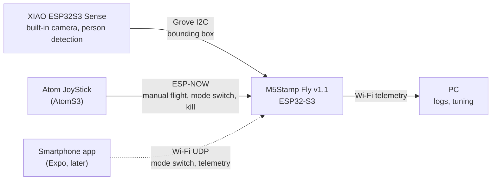

# Indoor AI Follow Drone

[English](README.md) | [Japanese](README.ja.md)

## Overview

> Status: planning. No firmware or app code yet. This README records the requirements and the development plan.

An indoor micro drone that finds a person and follows them on its own. It is based on the M5Stamp Fly v1.1 (ESP32-S3), with an XIAO ESP32S3 Sense (camera built in) added. The XIAO ESP32S3 Sense on the drone runs person detection. The flight controller turns the bounding box into yaw, roll, and pitch targets. A controller switches between manual flight and autonomous follow mode.

## Features

- Detect a person and follow them indoors at a fixed distance.
- Hold altitude and position with the built-in pressure, ToF, and optical-flow sensors.
- Switch between manual and autonomous modes from a controller, with an immediate manual override.
- Fly the follow logic in a simulator before flying real hardware.

### Out of scope

- Outdoor flight, GPS, or long range.
- Following several people, or recognizing a specific person.

## Architecture

| Layer          | Device                           | Role                                                                        |
| -------------- | -------------------------------- | --------------------------------------------------------------------------- |
| Edge AI        | XIAO ESP32S3 Sense               | Run person detection and report bounding boxes (x, y, w, h, score) over I2C |
| Flight control | M5Stamp Fly v1.1                 | Stabilize flight, read the AI results, run the follow PID, receive commands |
| Controller     | Atom JoyStick                    | Physical sticks for manual flight, mode switch, and emergency stop          |
| App (later)    | Smartphone (React Native / Expo) | Toggle follow mode, show telemetry, tune parameters                         |

### Follow control

| Input (from the bounding box)          | Error                           | Output target                     |
| -------------------------------------- | ------------------------------- | --------------------------------- |
| Horizontal center `x`                  | Offset from the image center    | Yaw rate (turn toward the person) |
| Box height `h` (stand-in for distance) | Difference from the target size | Pitch (forward and back)          |
| Vertical center `y`                    | Offset from the image center    | Optional: altitude target         |

- Use yaw first and add roll only if needed. Yaw is the easiest axis to tune.
- Add a deadband around the image center and the target size so the drone does not oscillate.
- If no person is detected for a timeout period, such as 0.5 s, stop following and hover.
- Clamp every follow output and keep it inside the limits of the attitude controller.

## Bill of Materials

| Part                                                                                    | Quantity | Role / Notes                                                                                                                                     |
| --------------------------------------------------------------------------------------- | -------- | ------------------------------------------------------------------------------------------------------------------------------------------------ |
| [M5Stamp Fly v1.1 (K138-V11)](https://link.amazon/B08fEUBrB)                            | 1        | Flight controller and airframe; ESP32-S3 (Stamp-S3A). About 27.6 g, 320 mAh battery, about 4 min flight. No controller included                  |
| [Atom JoyStick](https://link.amazon/B01ZRaFbh)                                          | 1        | Physical controller (AtomS3 + STM32). ESP-NOW link to the drone. Also works as a USB gamepad for the simulator                                   |
| [XIAO ESP32S3 Sense](https://link.amazon/B0gBKLuE7)                                     | 1        | Edge AI module (ESP32-S3, camera built in). Flash a person-detection model with SenseCraft AI and output the results over I2C                    |
| [Grove - Universal 4 Pin Buckled 5cm Cable (5 PCs Pack)](https://link.amazon/B00Grt336) | 1        | I2C between the XIAO and the Stamp Fly's red Grove port. Pack of five. The XIAO has no Grove connector, so cut one end and solder it to the XIAO |
| 3D-printed mount                                                                        | 1        | Holds the XIAO. See [the mount design in phase 4](#phase-4-payload-test)                                                                         |

The Grove Vision AI V2 and OV5647-62 kept for the Raspberry Pi can serve as a fallback if the inference rate is too low (see the phase 3 open questions).

### Spares

| Part                                                                                                                                              | Quantity  | Role / Notes                                                                                                                                                                                                              |
| ------------------------------------------------------------------------------------------------------------------------------------------------- | --------- | ------------------------------------------------------------------------------------------------------------------------------------------------------------------------------------------------------------------------- |
| [StampFly Accessory Kit (Motors + Propellers)](https://shop.m5stack.com/products/stampfly-accessory-kit-motors-propellers?variant=45727275680001) | As needed | Replacement parts after crashes (A147). Four propellers with 0.8 mm holes, coreless motors (two CW, two CCW), and a propeller removal tool. Check the spin direction when fitting them                                    |
| BETAFPV 1S 320mAh                                                                                                                                 | As needed | Spare battery. Same 4.35 V HV type as the one included with v1.1. No retailer selling it on its own has been found. From phase 4 onward, look for a 1S HV battery that matches the connector and size of the included one |

## Development

### Phases

| Phase                                                              | Goal                                                                         | Done when                                                                    |
| ------------------------------------------------------------------ | ---------------------------------------------------------------------------- | ---------------------------------------------------------------------------- |
| [1. Kit setup and test flight](#phase-1-kit-setup-and-test-flight) | Charge the battery, pair the Atom JoyStick, and fly the stock Stamp Fly      | Stable hover with altitude hold                                              |
| [2. Simulator](#phase-2-simulator)                                 | Run the follow logic in the StampFly ecosystem SILS with fake bounding boxes | The simulated drone turns toward and keeps its distance from a moving target |
| [3. AI module on the bench](#phase-3-ai-module-on-the-bench)       | Read XIAO ESP32S3 Sense results over I2C and print them to serial            | Bounding boxes arrive at a fixed rate with no flight running                 |
| [4. Payload test](#phase-4-payload-test)                           | Mount the AI module and check flight                                         | Stable hover with the payload; flight time recorded                          |
| [5. Yaw-only follow](#phase-5-yaw-only-follow)                     | Close the yaw loop on real hardware                                          | The drone turns to face a person                                             |
| [6. Full follow](#phase-6-full-follow)                             | Add pitch (distance) and optional roll                                       | The drone follows a person at a set distance                                 |
| [7. Smartphone app](#phase-7-smartphone-app)                       | Mode switch and telemetry from an Expo app                                   | Mode switch works from the app                                               |

Each phase holds its own hardware development, software development, tests, and results, so working through the phases from phase 1 builds the whole project. Move on only after the previous phase meets its done-when condition.

Safety: fly in a clear room with a net or soft floor. Wear eye protection. Start with low follow gains and low speed limits. Keep the controller in your hand during every autonomous flight.

### Phase 1: Kit setup and test flight

Fly the stock Stamp Fly to confirm that the drone and the controller work. This gives a baseline for finding the cause of problems in later phases.

#### Hardware Development

1. Charge the included battery (5 V 1 A, about 55 min).
2. Check the propeller direction and fit.
3. Turn on the Atom JoyStick and pair it with the Stamp Fly.

#### Software Development

- Use the factory firmware as is. Reflashing starts in phase 2.

#### Test

1. Take off at a low height and try hovering, moving in each direction, and landing.
2. Record the flight time of one battery, to compare with later phases.

| Test             | Method                                             | Pass criteria                                  |
| ---------------- | -------------------------------------------------- | ---------------------------------------------- |
| Hover            | Take off with altitude hold and release the sticks | Holds height and position without drifting far |
| Manual control   | Move each stick a little                           | The drone moves in the input direction         |
| Landing and stop | Land and stop the motors                           | Lands safely and the motors stop               |

### Phase 2: Simulator

Set up the development environment and build the follow logic in the simulator. The control code from this phase goes onto the drone from phase 5.

#### Specification

- Use [stampfly_ecosystem](https://github.com/M5Fly-kanazawa/stampfly_ecosystem) as the base firmware. The same control code runs in the simulator and on the drone, and it has a UDP API for the smartphone app.
- Implement the follow logic as an app created with `sf app new`, without changing the ecosystem itself.
- Build yaw and pitch targets from the bounding box, as in the [Follow control](#follow-control) table. Run the PID at the detection rate.
- Timestamp the input. Return to hover on stale data or when nothing is detected for the timeout.
- Priority: emergency stop > manual sticks > autonomous follow.

Base firmware comparison

| Base                                                                       | Environment                         | Pros                                                                                                                                  | Cons                                                                                    |
| -------------------------------------------------------------------------- | ----------------------------------- | ------------------------------------------------------------------------------------------------------------------------------------- | --------------------------------------------------------------------------------------- |
| [M5StampFly](https://github.com/M5Fly-kanazawa/M5StampFly) (official)      | Arduino / PlatformIO                | The SSCMA Arduino library works as is                                                                                                 | No simulator. Less structure for adding new control code                                |
| [stampfly_ecosystem](https://github.com/M5Fly-kanazawa/stampfly_ecosystem) | ESP-IDF v5.5.2 + FreeRTOS, `sf` CLI | SILS and 3D simulators, controller firmware, Wi-Fi telemetry and logs, UDP and a Tello SDK–compatible API, `sf app new` for user apps | Not Arduino. The SSCMA I2C protocol has to be ported or wrapped as an ESP-IDF component |

**Open questions**

| Item                | How to decide                                                                                                               |
| ------------------- | --------------------------------------------------------------------------------------------------------------------------- |
| v1.1 support        | Check in step 2. If it does not work, use the official M5StampFly (Arduino) on the drone and the simulator for logic only   |
| Lost-target timeout | Provisional 0.5 s. In the simulator, pick a value that survives a brief occlusion but stops quickly when the person is lost |

#### Hardware Development

1. Connect the Atom JoyStick to the PC over USB, to use it as the simulator's gamepad.

#### Software Development

1. Install the stampfly_ecosystem `sf` CLI (Python 3.10 to 3.12; the installer sets up ESP-IDF).
2. Flash the ecosystem firmware to the v1.1 and check that it flies by hand. The ecosystem README lists the MCU only as "M5Stamp S3" and does not mention the v1.1's StampS3A.
3. Start the SILS and fly it by hand with the Atom JoyStick.
4. Create a follow app with `sf app new` and implement the follow logic as described in Specification.
5. Generate fake bounding boxes from a virtual person's position and feed them to the follow logic.
6. Tune the follow PID gains, deadband, and output limits.

#### Test

| Test             | Method                         | Pass criteria                                |
| ---------------- | ------------------------------ | -------------------------------------------- |
| Simulator follow | SILS with a moving fake target | No oscillation; settles within a few seconds |
| Lost target      | Stop the fake target output    | Drone hovers within the timeout              |
| Manual override  | Move a stick during follow     | Manual control returns at once               |

### Phase 3: AI module on the bench

Connect the XIAO ESP32S3 Sense to the Stamp Fly and read detection results without flying.

#### Specification

**Wiring**

| XIAO ESP32S3 Sense        | M5Stamp Fly v1.1 (red Grove port) |
| ------------------------- | --------------------------------- |
| D4 / GPIO5 (SDA)          | G13 (SDA)                         |
| D5 / GPIO4 (SCL)          | G15 (SCL)                         |
| 3V3 or 5V (open question) | VCC                               |
| GND                       | GND                               |

- The Stamp Fly pin map shows the red Grove port as I2C (G13/G15) and the black port as G1/G2. Check the pins on the board before wiring.
- Cut one end of the Grove cable and solder it straight to the XIAO's pads. With no connector, vibration cannot pull it loose.
- The XIAO shares the flight battery, so it shortens the flight time. Measure its current draw.

**I2C read**

- Read the AI module in its own task, separate from the attitude control loop. A slow I2C read must never block stabilization.
- Pass the latest result with a timestamp so the follow logic can detect stale data.
- The XIAO outputs results over I2C with the SenseCraft AI firmware. The Stamp Fly reads them with the [Seeed_Arduino_SSCMA](https://github.com/Seeed-Studio/Seeed_Arduino_SSCMA) I2C protocol.

**Open questions**

| Item                   | How to decide                                                                                                                                       |
| ---------------------- | --------------------------------------------------------------------------------------------------------------------------------------------------- |
| Grove port voltage     | The documents do not say whether it is 3.3 V or 5 V. Measure it before wiring: connect 3.3 V to the XIAO's 3V3 pin, or 5 V to its 5V pin            |
| I2C pull-ups           | The XIAO's I2C may need pull-up resistors. Check whether the Stamp Fly side has them, and add them if not                                           |
| How to include SSCMA   | (a) Port only the result-reading part to ESP-IDF, or (b) use Arduino as a component. Try (a) first and pick the one that fits the build more easily |
| Person-detection model | Pick a SenseCraft AI model for the XIAO ESP32S3 Sense by comparing detection accuracy at 1 to 2 m and the inference rate                            |
| Changing the AI module | If the inference rate is too low for following, switch to the stored Grove Vision AI V2 and OV5647-62 (same I2C protocol)                           |

#### Hardware Development

1. Check that the camera board is firmly attached to the XIAO ESP32S3 Sense.
2. Measure the Grove port voltage, and solder one end of the 5 cm Grove cable to the XIAO's SDA, SCL, power, and GND.
3. Plug the other end into the Stamp Fly's red Grove port.
4. Remove the propellers, or work with the motors unable to spin.

#### Software Development

1. Flash a person-detection model to the XIAO ESP32S3 Sense with SenseCraft AI and set the output to I2C.
2. Implement the I2C read task on the Stamp Fly and print the results to serial.
3. Record the inference rate, latency, and current draw. The follow loop gains depend on them.

#### Test

| Test      | Method                        | Pass criteria                                                  |
| --------- | ----------------------------- | -------------------------------------------------------------- |
| I2C read  | Bench test with serial output | Stable rate; no blocking or bus errors                         |
| Detection | A person stands 1 to 2 m away | The person is detected steadily and the coordinates track them |

### Phase 4: Payload test

Build a mount for the XIAO ESP32S3 Sense, and confirm stable flight with the payload.

#### Specification

**Mount design**

Print a minimal mount on the Bambu Lab P1S. Design it around these rules:

1. **Keep the center of gravity in the middle.** Put the module's weight over the center of the frame. Front-heavy mounts make the drone drift forward, and the controller has to fight it all the time. If the camera must face forward, put the AI board behind the center to balance it.
2. **Do not block the sensors.** The bottom ToF and optical-flow sensors must see the floor, and the front ToF must see forward. Keep the mount and cables out of their fields of view.
3. **Keep clear of the propellers.** Leave at least 5 mm between the mount and each propeller disc, including the cable. Do not put large flat areas under the propellers; they block the downwash and reduce thrust.
4. **Keep it light.** Aim for a few grams for the mount itself. Use thin walls (0.8 to 1.2 mm), ribs instead of solid plates, and holes to cut mass.
5. **Damp vibration.** Motor vibration blurs the image and adds noise to the IMU. Use a small rubber or TPU damper, or foam tape, between the mount and the camera.
6. **Set the camera angle.** For a person at 1 to 2 m, start with the camera level or tilted slightly down (about 0 to 15°). Make the angle easy to change, for example with interchangeable wedges.
7. **Keep access.** Leave the battery, USB port, and power switch reachable without removing the mount.
8. **Attach without glue first.** Clip or band the mount to the frame so you can try several designs. Do not drill the PCB frame.
9. **Hold the camera board.** The XIAO ESP32S3 Sense stacks the camera board on the main board through a board-to-board connector. Press it down with the mount so vibration cannot pop it off.

**Open questions**

| Item           | How to decide                                                                                               |
| -------------- | ----------------------------------------------------------------------------------------------------------- |
| Mount position | Choose top, front, or bottom: keep the center of gravity in the middle and clear the sensors and propellers |
| Attachment     | Choose a clip or a band: it must not damage the drone or loosen in flight                                   |
| Camera angle   | Start at 0 to 15° down, and adjust in phases 5 and 6 so the person sits near the image center               |

#### Hardware Development

1. Measure the frame, the mounting points, and the module sizes with calipers. Photograph the drone from the top, side, and front.
2. Design and print a simple tray or clip. Expect several versions. PETG or PLA is fine for early fit tests.
3. Print the final shape in ABS. The enclosed P1S suits ABS, but ABS shrinks and warps, so check the fit after printing.
4. Weigh the full payload (mount, XIAO, cable) on a scale.
5. Fit it to the drone and check that the center of gravity is in the middle.
6. Log the weight, the center of gravity, and the hover throttle for each version.
7. Get a spare battery if needed, since flights become frequent from here.

#### Software Development

- Keep the phase 3 firmware (follow is not running yet).
- Log the hover throttle and battery voltage with Wi-Fi telemetry.

#### Test

| Test                | Method                                  | Pass criteria                                       |
| ------------------- | --------------------------------------- | --------------------------------------------------- |
| Payload hover       | Hover with the full payload             | Stable hover; flight time recorded                  |
| Sensor view         | Use altitude hold with the payload      | ToF and optical flow work normally                  |
| Detection in flight | A person stands in front while hovering | Detection results still arrive in serial or the log |

### Phase 5: Yaw-only follow

Load the phase 2 follow logic onto the drone and make it turn to face a person, using yaw only.

#### Hardware Development

- Use the drone with the payload from phase 4.

#### Software Development

1. Feed the phase 3 I2C read task's results into the phase 2 follow app.
2. Fix the pitch and roll outputs at zero and enable yaw only.
3. Flash the drone with lower gains than the ones tuned in phase 2.
4. Assign a follow-mode toggle to an Atom JoyStick button.

#### Test

1. Switch to follow mode while hovering, and have the person move slowly left and right.
2. Raise the gains step by step.

| Test            | Method                          | Pass criteria                                    |
| --------------- | ------------------------------- | ------------------------------------------------ |
| Yaw follow      | The person moves left and right | The drone turns to face them without oscillating |
| Lost target     | Hide the person from the camera | Drone hovers within the timeout                  |
| Manual override | Move a stick during follow      | Manual control returns at once                   |
| Emergency stop  | Press the kill input            | Motors stop at once                              |

### Phase 6: Full follow

Add distance control so the drone follows at a set distance.

#### Specification

**Open questions**

| Item            | How to decide                                                                                   |
| --------------- | ----------------------------------------------------------------------------------------------- |
| Add roll        | Add it only if, with yaw and pitch alone, a person walking sideways leaves the image            |
| Target distance | Pick a distance from 1 to 2 m with steady detection, and use the box height there as the target |

#### Hardware Development

- Use the same drone as phase 5. If the camera angle does not suit following, adjust the mount angle.

#### Software Development

1. Enable pitch (distance) control from the box height.
2. Decide whether to add roll, following the open question.
3. Tune the target distance (target box height) and the speed limits.

#### Test

| Test            | Method                            | Pass criteria                         |
| --------------- | --------------------------------- | ------------------------------------- |
| Distance hold   | The person walks forward and back | The drone follows at the set distance |
| Lost target     | Hide the person from the camera   | Drone hovers within the timeout       |
| Manual override | Move a stick during follow        | Manual control returns at once        |
| Emergency stop  | Press the kill input              | Motors stop at once                   |

### Phase 7: Smartphone app

Add mode switching and telemetry from a smartphone. The Atom JoyStick stays the main manual control.

#### Specification

- Use Wi-Fi UDP (not BLE), because the ecosystem has a UDP and Tello SDK–compatible API.
- The Atom JoyStick is the main manual control. JoyStick input always takes priority over the app.

**Open questions**

| Item          | How to decide                                                                         |
| ------------- | ------------------------------------------------------------------------------------- |
| Virtual stick | Add it as a backup only if, by phase 6, you want to fly without the JoyStick at times |

#### Hardware Development

- Connect the smartphone to the drone's Wi-Fi access point.

#### Software Development

1. Build the app with React Native (Expo).
2. Send mode commands over Wi-Fi UDP.
3. Show the drone's telemetry.

#### Test

| Test            | Method                               | Pass criteria                        |
| --------------- | ------------------------------------ | ------------------------------------ |
| Mode switch     | Toggle follow mode in the app        | The drone changes mode               |
| Link loss       | Close the app during follow          | The drone falls back to a safe hover |
| Manual override | Move a stick while the app is in use | Atom JoyStick input takes priority   |

## References

- [M5Stamp Fly v1.1 (K138-V11)](https://docs.m5stack.com/en/products/sku/K138-V11)
- [StampFly v1.1 app guide](https://docs.m5stack.com/en/app/StampFly_v1.1)
- [Atom JoyStick](https://docs.m5stack.com/en/app/Atom%20JoyStick)
- [M5StampFly official firmware](https://github.com/M5Fly-kanazawa/M5StampFly)
- [stampfly_ecosystem](https://github.com/M5Fly-kanazawa/stampfly_ecosystem)
- [XIAO ESP32S3 Sense](https://wiki.seeedstudio.com/xiao_esp32s3_getting_started/)
- [SenseCraft AI: Using XIAO ESP32S3 Sense as an AI sensor](https://sensecraft.seeed.cc/wiki/en/sensecraft-ai/guides/models/workspace/sensecraft-ai-output-libraries-xiao/)
- [Grove Vision AI V2](https://wiki.seeedstudio.com/grove_vision_ai_v2/) (fallback)
- [Seeed_Arduino_SSCMA](https://github.com/Seeed-Studio/Seeed_Arduino_SSCMA)
- Related project: [Vision AI Camera](../../../../sbc/Raspberry_Pi_5/Vision_AI_Camera/README.md)

## License

## Support

If you find this helpful, consider supporting the work:

## Author

[Asami.K](https://asami.tokyo/)
