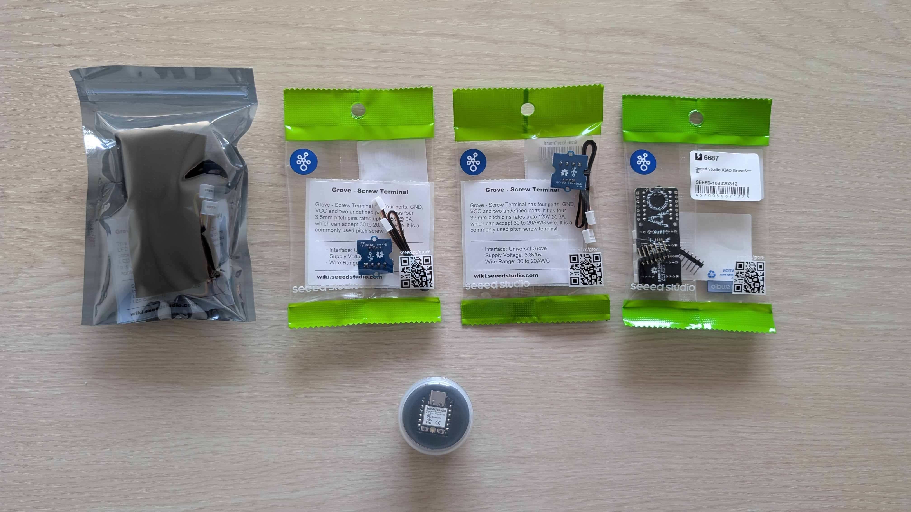
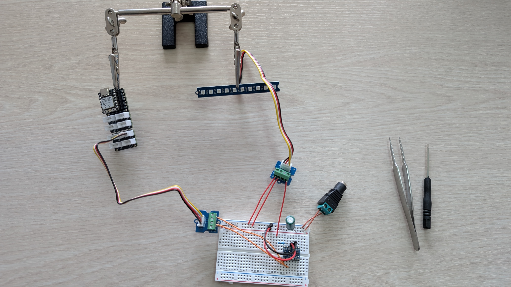
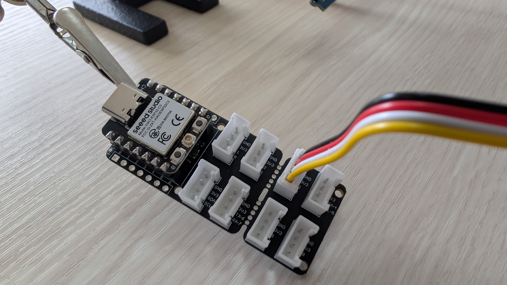
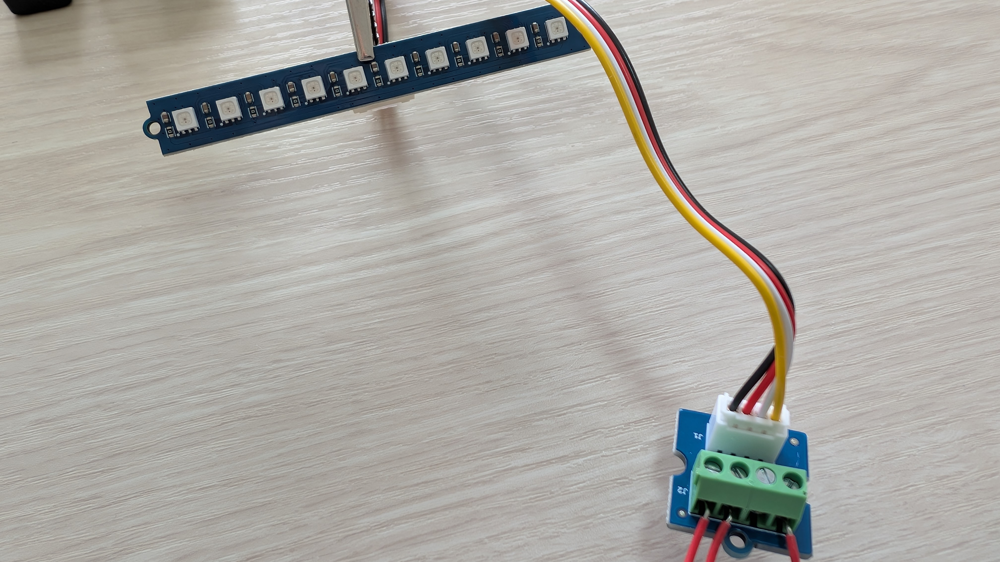
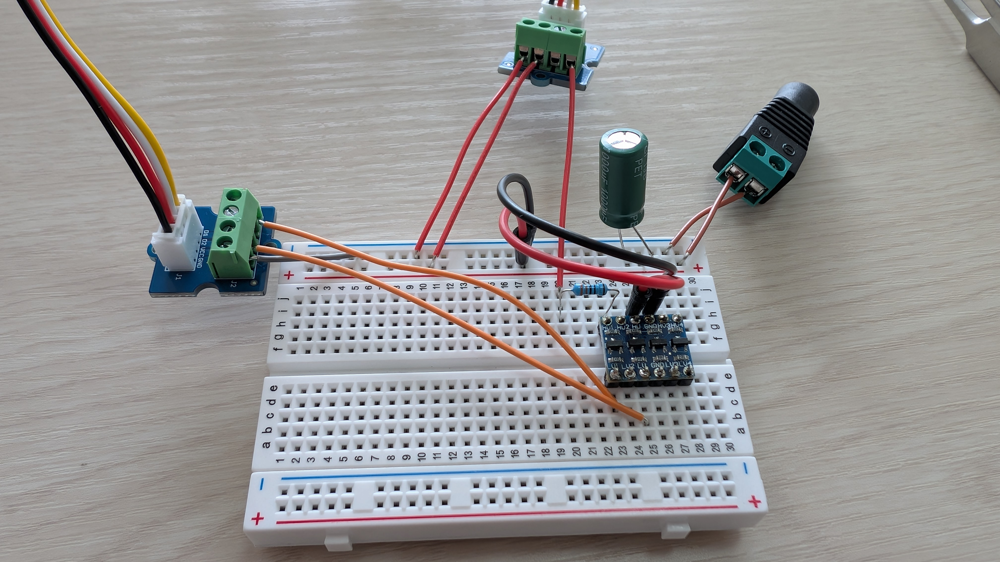
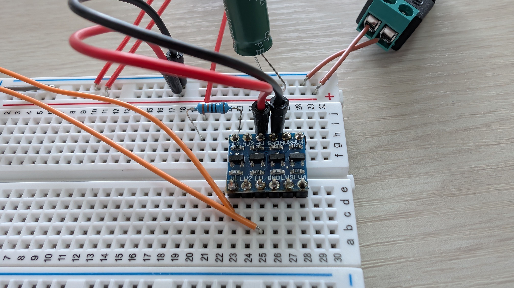
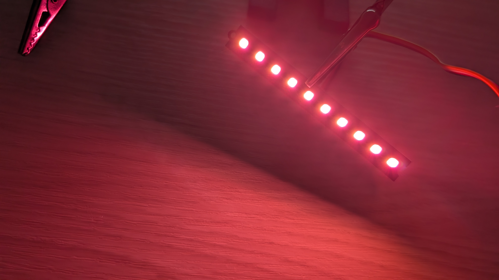
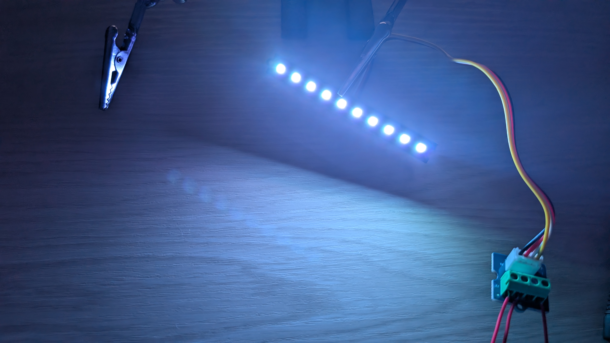
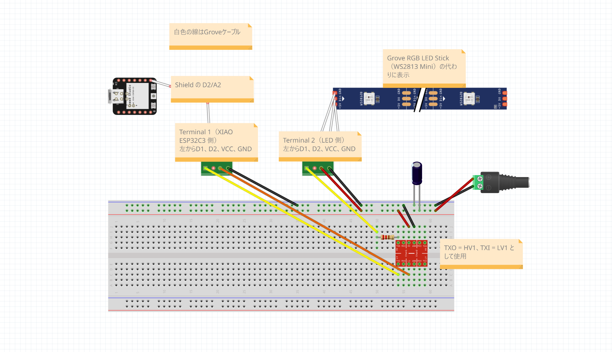

# XIAO ESP32C3 LED Color Preview

[English](README.md) | [Japanese](README.ja.md)

## Overview

A simple device for previewing LED colors with a Grove RGB LED Stick. Adjust the LED color and brightness from a smartphone with Arduino IoT Remote.

## Bill of Materials

### Control System

| Part | Quantity | Role / Notes |
| --- | --- | --- |
| [XIAO ESP32C3 PRE-SOLDERED](https://link.amazon/B0c237jnG) | 1 | Main controller with WiFi; headers pre-soldered |
| [Seeed Studio XIAO Grove Shield](https://jp.seeedstudio.com/Grove-Shield-for-Seeeduino-XIAO-p-4621.html) | 1 | Grove connection interface |

### Input & Output

| Part | Quantity | Role / Notes |
| ---------------------------------------------- | ---- | -------------- |
| [Grove RGB LED Stick 104020131](https://jp.seeedstudio.com/Grove-RGB-LED-Stick-10-WS2813-Mini.html) | 1 | Ten WS2813 Mini LEDs; Grove cable included |

### Power System

| Part | Quantity | Role / Notes |
| ------------------------------------------------------------------------------------------------- | ---- | ---------------------------------------- |
| [Power Supply (5V, 2A+)](https://amzn.to/4jZEIyu) or [Mobile Power Bank](https://amzn.to/45jTQ5W) | 1    | Power supply for LEDs.                   |
| [Grove Screw Terminal](https://link.amazon/B022xHEM0) | 2 | Separate Shield-side and LED-side wiring without cutting cables |
| [DC jack adapter (female)](https://amzn.to/3IdZI7k)                                               | 1    | Connect the AC adapter to the breadboard |
| [Logic Level Shifter](https://amzn.to/4eeDyhr) | 1     | To convert the data signal voltage. |
| [Electrolytic Capacitor (1000µF)](https://amzn.to/45ZOWLQ)                                        | 1    | For power supply stabilization           |

### Prototyping & Wiring

| Part | Quantity | Role / Notes |
| ---------------------------------------------- | ----- | ---------------------------------- |
| [Breadboard](https://amzn.to/40bMzlk)          | 1     | Circuit base (for prototype)       |
| [Jumper Wires](https://amzn.to/45voWYC)        | 1 set | Connecting parts together; 22AWG solid wire recommended. Grove Screw Terminal accepts 20–30AWG. |
| [Resistor (300-500Ω)](https://amzn.to/4kMejW2) | 1     | For protecting the LED's data line |
| [USB-C Cable](https://amzn.to/4lU4bdZ)        | 1    | For programming and powering . |

## Development

### Hardware Development

#### Breadboard diagram

Fritzing source: [LED_Color_Preview.fzz](diagrams/LED_Color_Preview.fzz)

The diagram's notes are in Japanese.

#### Wiring steps

> [!IMPORTANT]
> Keep the USB-C cable and the external 5V supply unplugged while wiring.

Wire colors follow the diagram (yellow: signal, orange: 3.3V, red: 5V, black: GND, white: Grove cable).

1. **Mount XIAO ESP32C3 on the Grove Shield**
   - Check the orientation against the Shield's silkscreen.
2. **Connect XIAO ESP32C3 to the LED**
   - Use Grove cables to connect the Shield's D2/A2 port ([pinout](https://jp.seeedstudio.com/Grove-Shield-for-Seeeduino-XIAO-p-4621.html)) to Grove Screw Terminal 1, and the LED Stick to Grove Screw Terminal 2 ([Grove Screw Terminal schematic](https://files.seeedstudio.com/wiki/Grove-Screw_Terminal/res/Grove-Screw_Terminal_v1.0.zip)).
   - Before connecting the orange wire, connect only XIAO ESP32C3 and the Shield to USB-C and measure about 3.3V between Grove Screw Terminal 1 VCC and GND with a multimeter. If it reads 5V, do not connect it; that can damage XIAO ESP32C3. Unplug USB-C after measuring.
   - Connect the yellow and orange wires and the 330Ω resistor as shown in the diagram. Only channel 1 (LV1/HV1) of the level shifter is used.
3. **Connect the power**
   - Connect the red and black wires and the 1000µF capacitor as shown in the diagram.
   - Insert the capacitor's striped lead into the − rail.
4. **Check before powering on**
   - No short between the + and − rails (check with a multimeter).
   - The external supply is 5V (do not use 9V or 12V).
   - Screw terminals are tight and no bare wires touch each other. Do not force thick wire (such as 18AWG) into Grove terminals.
5. **Power on**
   - Plug in the external 5V supply, then USB-C. Disconnect in reverse order.

#### Current and optional protection

All ten LEDs at full-brightness white draw only about 0.5A, so a fuse is not required; to add one as short-circuit protection, place the following parts between the DC jack + and the + rail.

- [Littelfuse 0287001.PXCN](https://www.marutsu.co.jp/pc/i/2563488/) (1A, DC32V, ATO)
- [FHAC0002ZXJ holder](https://www.marutsu.co.jp/pc/i/15761797/)

### Software Development

#### Development steps

> [!NOTE]
> Internet access and an Arduino Cloud plan that allows four variables are required.

1. **Prepare the Arduino IDE**
   - Launch the Arduino IDE.
   - In the Boards Manager, install `esp32 by Espressif Systems`.
   - In the Library Manager, install `ArduinoIoTCloud` and `Adafruit_NeoPixel`.
2. **Connect XIAO ESP32C3 to the PC**
   - With USB-C unplugged, attach the [Wi-Fi antenna](https://files.seeedstudio.com/wiki/XIAO_WiFi/XIAO_ESP32-C3_front_pinout.png) to XIAO ESP32C3.
   - Connect XIAO ESP32C3 to the PC with a USB-C cable.
   - In the Arduino IDE, select `XIAO_ESP32C3` as the board and select the XIAO ESP32C3 port.
3. **Register the device in Arduino Cloud**
   - Open [Arduino Cloud](https://app.arduino.cc/) in a browser and sign in.
   - In Devices, register XIAO ESP32C3 as a third-party ESP32 device, and save the Device ID and Secret Key shown.
4. **Create a Thing**
   - In the Arduino Cloud left menu, open Things and press + Thing (Create Thing). Rename the Thing at the top of the page, for example to `LED_Color_Preview`.
   - Under Associated Device, press Select Device, choose the device registered in step 3, and press Associate.
   - Under Network, press Configure, enter the following, and press Save.
     - Wi-Fi Name: the SSID of a 2.4GHz Wi-Fi network (5GHz is not supported)
     - Password: the Wi-Fi password
     - Secret Key: the Secret Key saved in step 3
   - Under Cloud Variables, press + Add (Add Variable) and add a variable with the following settings. Repeat for `red`, `green`, `blue`, and `brightness`.
     - Name: the variable name (for example, `red`). Enter it exactly, because it becomes the variable name in the sketch.
     - Type: Integer Number
     - Variable Permission: Read & Write
     - Variable Update Policy: On change
5. **Upload the sketch**
   - Copy [credentials.h.example](sketch/LED_Color_Preview/credentials.h.example) and rename the copy to `credentials.h`.
   - Enter the following values in `credentials.h` and save it.
     - `SECRET_DEVICE_ID`: the Device ID from step 3
     - `SECRET_DEVICE_KEY`: the Secret Key from step 3
     - `SECRET_SSID`: the SSID of a 2.4GHz Wi-Fi network
     - `SECRET_OPTIONAL_PASS`: the Wi-Fi password
   - In the Arduino IDE, open [LED_Color_Preview.ino](sketch/LED_Color_Preview/LED_Color_Preview.ino) with File → Open.
   - Press the Verify button and confirm that the sketch compiles without errors, then press the Upload button to upload the sketch.
     - If the upload fails, hold the B (BOOT) button, press and release the R (RESET) button, release the B button, and press Upload again.
   - Open Tools → Serial Monitor and set the speed to 115200 baud. If **WiFi.status(): 3** appears, Wi-Fi is connected.
   - In Arduino Cloud Devices, confirm that the device is Online.
6. **Create the dashboard**
   - Select Linked Dashboards and click **Build dashboard**.
   - Add four Sliders with a 0–255 range, linked to `red`, `green`, `blue`, and `brightness`.
7. **Control from a smartphone**
   - Install the [Arduino IoT Cloud Remote app](https://cloud.arduino.cc/iot-remote-app/) on your smartphone.
   - Open the dashboard in the Arduino IoT Cloud Remote app.
   - Operate the dashboard as described in the Test section.

### Test

- Set brightness above 0.
- Show red, green, and blue one at a time and confirm that the LEDs light in the specified color.
- If the colors differ, fix the color order in the sketch (change `NEO_GRB` to `NEO_RGB`, etc.).

## References

### Common guides

- [Arduino development](../../../../docs/arduino-development.md)
- [Credentials](../../../../docs/credentials.md)

- [XIAO ESP32C3 Documentation and Pinout](https://wiki.seeedstudio.com/XIAO_ESP32C3_Getting_Started/)
- [Grove Shield for XIAO](https://wiki.seeedstudio.com/Grove-Shield-for-Seeeduino-XIAO-embedded-battery-management-chip/)
- [Grove RGB LED Stick Specifications and Pinout](https://wiki.seeedstudio.com/Grove-RGB_LED_Stick-10-WS2813_Mini/)
- [Arduino Cloud / IoT Remote](https://cloud.arduino.cc/how-it-works/)
- [Grove-to-Jumper Conversion Cable](https://jp.seeedstudio.com/Grove-4-pin-Female-Jumper-to-Grove-4-pin-Conversion-Cable-5-PCs-per-PAck.html)
- [Grove Screw Terminal](https://wiki.seeedstudio.com/Grove-Screw_Terminal/)
- [Grove Screw Terminal schematic (Eagle/PDF)](https://files.seeedstudio.com/wiki/Grove-Screw_Terminal/res/Grove-Screw_Terminal_v1.0.zip)

## Author

[Asami.K](https://asami.tokyo/)

